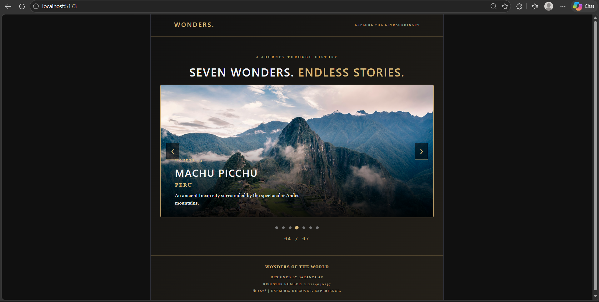
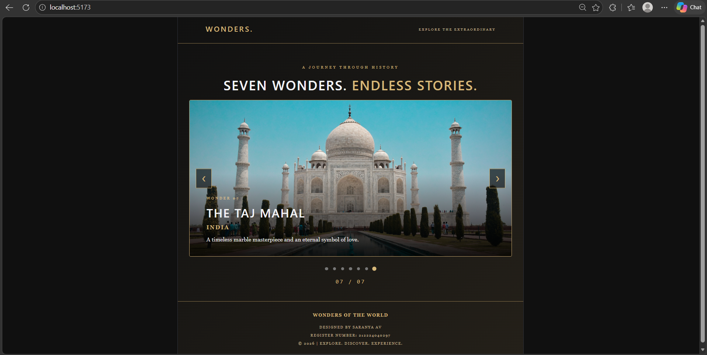

# Ex05 Image Carousel
## Date: 21-11-2026
## Name: Saranya AV
## Reg No: 212224040297


## AIM
To create a Image Carousel using React 

## ALGORITHM
### STEP 1 Initial Setup:
Input: A list of images to display in the carousel.

Output: A component displaying the images with navigation controls (e.g., next/previous buttons).

### Step 2 State Management:
Use a state variable (currentIndex) to track the index of the current image displayed.

The carousel starts with the first image, so initialize currentIndex to 0.

### Step 3 Navigation Controls:
Next Image: When the "Next" button is clicked, increment currentIndex.

If currentIndex is at the end of the image list (last image), loop back to the first image using modulo:
currentIndex = (currentIndex + 1) % images.length;

Previous Image: When the "Previous" button is clicked, decrement currentIndex.

If currentIndex is at the beginning (first image), loop back to the last image:
currentIndex = (currentIndex - 1 + images.length) % images.length;

### Step 4 Displaying the Image:
The currentIndex determines which image is displayed.

Using the currentIndex, display the corresponding image from the images list.

### Step 5 Auto-Rotation:
Set an interval to automatically change the image after a set amount of time (e.g., 3 seconds).

Use setInterval to call the nextImage() function at regular intervals.

Clean up the interval when the component unmounts using clearInterval to prevent memory leaks.

## PROGRAM
App.css
```

* {
  margin: 0;
  padding: 0;
  box-sizing: border-box;
}

body {
  font-family: Georgia, serif;
  background: #101010;
  color: #ffffff;
}

.website {
  min-height: 100vh;
  background: linear-gradient(135deg, #111111, #242019);
}

.navbar {
  display: flex;
  justify-content: space-between;
  align-items: center;
  padding: 25px 8%;
  border-bottom: 1px solid #8c754b;
}

.navbar h2 {
  color: #d6b779;
  letter-spacing: 4px;
}

.navbar p {
  color: #c5b48f;
  font-size: 11px;
  letter-spacing: 3px;
}

.hero {
  text-align: center;
  padding: 65px 20px 50px;
}

.tagline {
  color: #d6b779;
  letter-spacing: 5px;
  font-size: 12px;
  margin-bottom: 20px;
}

.hero h1 {
  font-size: 43px;
  letter-spacing: 3px;
  margin-bottom: 35px;
}

.hero h1 span {
  color: #d6b779;
}

.carousel {
  position: relative;
  max-width: 1050px;
  height: 510px;
  margin: auto;
  overflow: hidden;
  border: 1px solid #c3a36b;
  border-radius: 5px;
  background: #222;
}

.wonder-image {
  width: 100%;
  height: 100%;
  object-fit: cover;
  display: block;
}

.image-overlay {
  position: absolute;
  bottom: 0;
  left: 0;
  width: 100%;
  text-align: left;
  padding: 65px 55px 40px;
  background: linear-gradient(
    transparent,
    rgba(0, 0, 0, 0.9)
  );
}

.number {
  color: #e0c28b;
  font-size: 12px;
  letter-spacing: 4px;
  margin-bottom: 12px;
}

.image-overlay h2 {
  font-size: 38px;
  letter-spacing: 3px;
}

.image-overlay h4 {
  color: #d6b779;
  margin-top: 12px;
  letter-spacing: 3px;
}

.description {
  color: #eeeeee;
  margin-top: 12px;
  max-width: 550px;
  line-height: 1.6;
}

.previous,
.next {
  position: absolute;
  top: 50%;
  transform: translateY(-50%);
  border: 1px solid #d6b779;
  background: rgba(0, 0, 0, 0.6);
  color: #d6b779;
  font-size: 23px;
  padding: 15px 19px;
  cursor: pointer;
}

.previous {
  left: 20px;
}

.next {
  right: 20px;
}

.previous:hover,
.next:hover {
  background: #d6b779;
  color: #111;
}

.indicators {
  margin-top: 25px;
}

.dot {
  width: 10px;
  height: 10px;
  border-radius: 50%;
  border: none;
  background: #777;
  margin: 0 8px;
  cursor: pointer;
}

.dot.active {
  background: #d6b779;
  transform: scale(1.4);
}

.counter {
  margin-top: 18px;
  color: #d6b779;
  letter-spacing: 4px;
}

footer {
  text-align: center;
  border-top: 1px solid #8c754b;
  padding: 30px 15px;
  color: #c5b48f;
  font-size: 12px;
  letter-spacing: 2px;
  line-height: 2.2;
}

footer h3 {
  color: #d6b779;
  margin-bottom: 10px;
}

@media (max-width: 600px) {
  .navbar {
    padding: 20px;
  }

  .navbar p {
    font-size: 8px;
  }

  .hero h1 {
    font-size: 27px;
  }

  .carousel {
    height: 380px;
  }

  .image-overlay {
    padding: 50px 20px 25px;
  }

  .image-overlay h2 {
    font-size: 24px;
  }

  .description {
    font-size: 12px;
  }

  .previous,
  .next {
    padding: 10px 13px;
    font-size: 16px;
  }
}

```
App.jsx
```

import React, { useState, useEffect } from "react";
import "./App.css";

function App() {

  const wonders = [
    {
      name: "THE GREAT WALL",
      country: "CHINA",
      description: "An extraordinary ancient structure stretching across China's historic landscapes.",
      image: "https://images.unsplash.com/photo-1508804185872-d7badad00f7d?w=1600"
    },
    {
      name: "PETRA",
      country: "JORDAN",
      description: "The magnificent rose-red city carved into the sandstone cliffs.",
      image: "https://images.unsplash.com/photo-1579606032821-4e6161c81bd3?w=1600"
    },
    {
      name: "CHRIST THE REDEEMER",
      country: "BRAZIL",
      description: "A breathtaking monument overlooking the beautiful city of Rio de Janeiro.",
      image: "https://images.unsplash.com/photo-1483729558449-99ef09a8c325?w=1600"
    },
    {
      name: "MACHU PICCHU",
      country: "PERU",
      description: "An ancient Incan city surrounded by the spectacular Andes mountains.",
      image: "https://images.unsplash.com/photo-1526392060635-9d6019884377?w=1600"
    },
    {
      name: "CHICHEN ITZA",
      country: "MEXICO",
      description: "A remarkable Mayan archaeological masterpiece with a legendary pyramid.",
      image: "https://images.unsplash.com/photo-1518638150340-f706e86654de?w=1600"
    },
    {
      name: "THE COLOSSEUM",
      country: "ITALY",
      description: "An iconic Roman amphitheatre representing the power of ancient Rome.",
      image: "https://images.unsplash.com/photo-1552832230-c0197dd311b5?w=1600"
    },
    {
      name: "THE TAJ MAHAL",
      country: "INDIA",
      description: "A timeless marble masterpiece and an eternal symbol of love.",
      image: "https://images.unsplash.com/photo-1564507592333-c60657eea523?w=1600"
    }
  ];

  const [currentIndex, setCurrentIndex] = useState(0);

  const nextImage = () => {
    setCurrentIndex((prev) => (prev + 1) % wonders.length);
  };

  const prevImage = () => {
    setCurrentIndex(
      (prev) => (prev - 1 + wonders.length) % wonders.length
    );
  };

  useEffect(() => {
    const timer = setInterval(nextImage, 3000);

    return () => clearInterval(timer);
  }, []);

  return (
    <div className="website">

      <nav className="navbar">
        <h2>WONDERS.</h2>
        <p>EXPLORE THE EXTRAORDINARY</p>
      </nav>

      <section className="hero">

        <p className="tagline">A JOURNEY THROUGH HISTORY</p>

        <h1>
          SEVEN WONDERS.
          <span> ENDLESS STORIES.</span>
        </h1>

        <div className="carousel">

          

          <div className="image-overlay">

            <p className="number">
              WONDER 0{currentIndex + 1}
            </p>

            <h2>{wonders[currentIndex].name}</h2>

            <h4>{wonders[currentIndex].country}</h4>

            <p className="description">
              {wonders[currentIndex].description}
            </p>

          </div>

          <button className="previous" onClick={prevImage}>
            &#10094;
          </button>

          <button className="next" onClick={nextImage}>
            &#10095;
          </button>

        </div>

        <div className="indicators">

          {wonders.map((wonder, index) => (
            <button
              key={index}
              className={
                currentIndex === index ? "dot active" : "dot"
              }
              onClick={() => setCurrentIndex(index)}
              aria-label={`Show ${wonder.name}`}
            />
          ))}

        </div>

        <p className="counter">
          0{currentIndex + 1} / 07
        </p>

      </section>

      <footer>
        <h3>WONDERS OF THE WORLD</h3>
        <p>DESIGNED BY SARANYA AV</p>
        <p>REGISTER NUMBER: 212224040297</p>
        <p>© 2026 | EXPLORE. DISCOVER. EXPERIENCE.</p>
      </footer>

    </div>
  );
}

export default App;

```


## OUTPUT



## RESULT
The program for creating Image Carousel using React is executed successfully.
